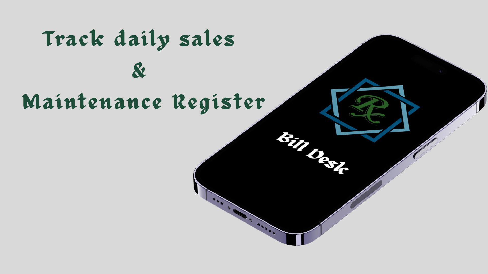
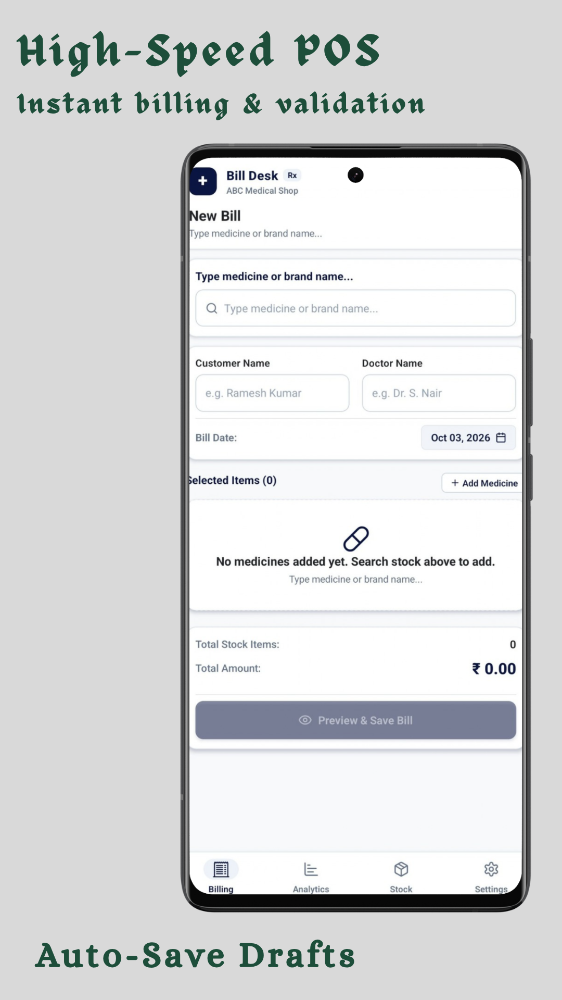
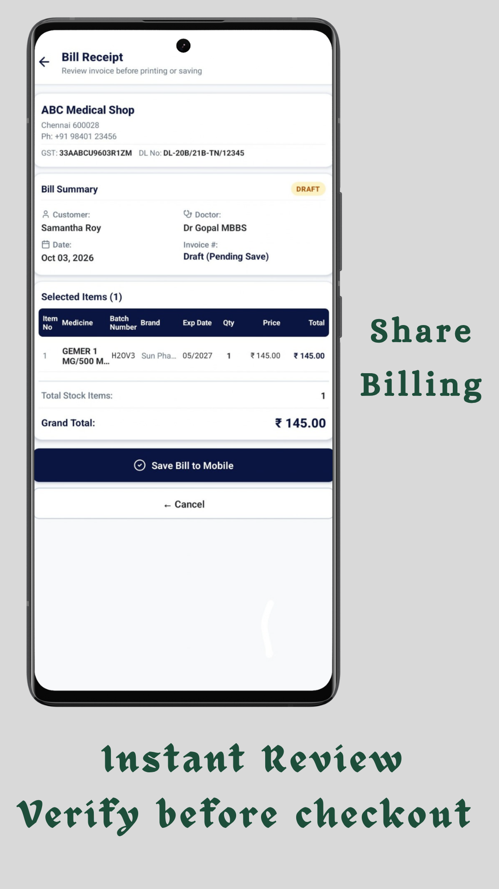
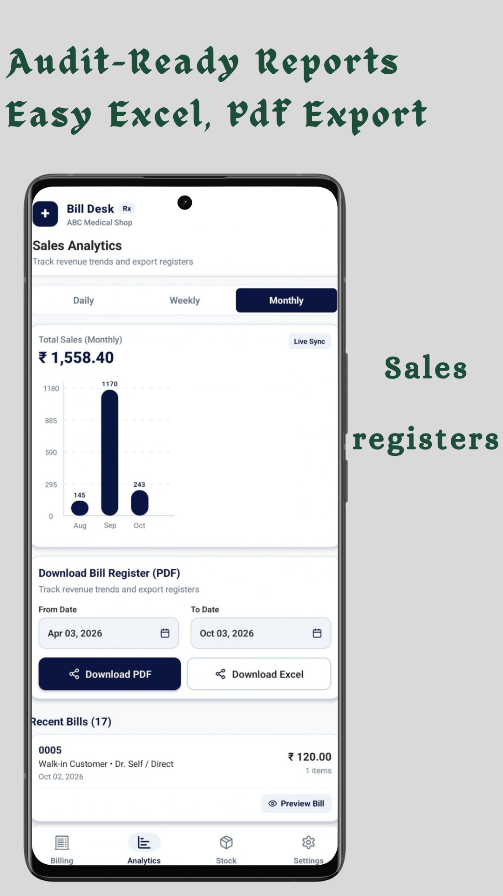
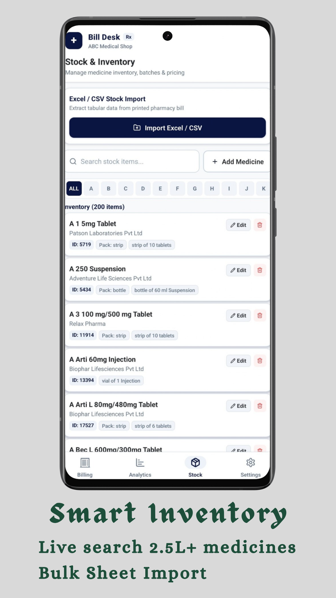
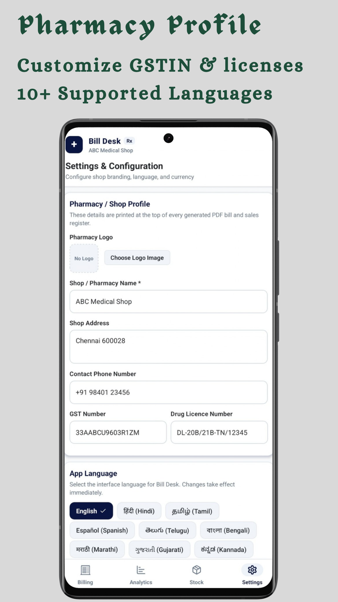

# 💊 Bill Desk

**Offline-first pharmacy billing and statutory drug-sales register app for retail pharmacies, medical shops, and chemists.**

[](#-download--install)
[](https://expo.dev/)
[](https://www.typescriptlang.org/)
[](#-download--install)
[](./LICENSE)

<p align="center">
  
</p>

---

## ✨ Key Highlights

* 🧾 **Fast POS billing**: search 250,000+ medicines instantly and check out in seconds.
* 📒 **Audit-ready registers**: statutory drug-sales register exported as PDF or Excel.
* 📴 **100% offline**: no internet, no server, no account. Data stays on your device.
* 📦 **Built-in inventory**: pre-loaded medicine catalog plus bulk Excel/CSV/JSON import.
* 🌐 **17 languages**: switch on the fly, including 15 Indian languages.

---

## 📱 Screenshots

<table align="center">
  <tr>
    <td align="center" width="33%">
      <br />
      <b>High-Speed POS Billing</b><br />
      <sub>Instant search, cart & auto-save drafts</sub>
    </td>
    <td align="center" width="33%">
      <br />
      <b>Bill Review & Receipt</b><br />
      <sub>Verify before checkout & share via PDF</sub>
    </td>
    <td align="center" width="33%">
      <br />
      <b>Sales Analytics & Registers</b><br />
      <sub>Audit-ready PDF & Excel reports</sub>
    </td>
  </tr>
</table>

<table align="center">
  <tr>
    <td align="center" width="50%">
      <br />
      <b>Smart Inventory Management</b><br />
      <sub>2.5L+ pre-loaded medicines & bulk import</sub>
    </td>
    <td align="center" width="50%">
      <br />
      <b>Pharmacy Profile & Multi-Language</b><br />
      <sub>GSTIN, Drug License No & 17 languages</sub>
    </td>
  </tr>
</table>

---

## 📥 Download & Install

<p align="center">
  <a href="https://github.com/acdeena1994/BILL_DESK/raw/refs/heads/main/Bill%20Desk.apk?download=">
    
  </a>
</p>

<p align="center">
  <a href="https://github.com/acdeena1994/BILL_DESK/raw/refs/heads/main/Bill%20Desk.apk?download=">👉 <b>Click here to download Bill Desk.apk</b></a>
</p>

| | |
|---|---|
| **Version** | 1.0.0 |
| **Requires** | Android 7.0+ (API 24) |

### Install on your phone

1. Tap the download button above on your Android phone (or copy the `.apk` to it).
2. Open the downloaded file.
3. If prompted, allow **Install from unknown sources**, then tap **Install**.

**Or install via ADB:**

```bash
adb install -r "Bill Desk.apk"
```

> ⚠️ Only install the APK from this repository.

---

## 🚀 Features

### 1. High-Speed POS Billing
* **250,000+ medicine search**: instant indexed autocomplete by brand, medicine name, or manufacturer.
* **Dynamic cart editing**: inline edit of quantity, batch number, expiry date (`MM/YY` with validation), and decimal unit prices.
* **Ad-hoc custom items**: add uncataloged medicines without leaving the sale.
* **Prescription & patient tracking**: record customer/patient name and prescribing doctor per invoice.
* **Draft autosave & crash recovery**: in-progress bills are preserved in `AsyncStorage`; the app offers to resume on next launch.
* **Bill review screen**: verify items, taxes, quantities, and totals before committing.
* **Atomic checkout**: bill, line items, and stock deductions are written in a single SQLite transaction (`db.withTransactionAsync`).
* **Invoice sharing**:
  * **PDF invoice** (thermal / A4) with shop logo, GSTIN, and Drug License No.
  * **WhatsApp receipt**: formatted plain-text bill via the native share sheet.

### 2. Register & Analytics
* **Audit-ready register** recording Bill No, Date, Doctor Name, Customer/Patient Name, Medicine Name, Quantity, Batch Number, Brand Name, Expiry Date, Price, and a Pharmacist Signature line.
* **Date-range filtering**: presets (Today, Last 7 Days, Last 6 Weeks, Last 6 Months) or a custom From–To picker.
* **PDF register export**: multi-page, formatted, with pharmacy header (name, address, phone, GSTIN, DL No).
* **Excel (.xlsx) export** for audits, tax filing, and accounting software.
* **Revenue charts**: daily (7 days), weekly (6 weeks), and monthly (6 months) trends via `react-native-gifted-charts`.
* **Invoice history drilldown**: full line items, doctor, and customer details for past bills.

### 3. Inventory & Stock
* **Pre-bundled catalog**: 250,000+ medicines in a 66 MB SQLite database installed on first launch (source dataset included in [`Stock_Database/`](./Stock_Database): `stock.csv` & `stock.json`).
* **A–Z quick filter** combined with live text search.
* **Manual stock management**: add or edit Product ID, Batch Number, Brand, Manufacturer, Pack Unit, Expiry Date, Price, and Quantity.
* **Bulk import** from `.xlsx`, `.xls`, `.csv`, or `.json`.
* **Import archiving**: imported files are backed up in the app sandbox (`stock/imports/`).

#### 📄 Stock Bundle File Format (Excel / CSV & JSON)
To import a new stock bundle in the app (**Stock → Import**), save your file as **Excel (`.xlsx` / `.xls`)**, **CSV (`.csv`)**, or **JSON (`.json`)** using the 5-field structure from [`Stock_Database/`](./Stock_Database):

**1. Excel (`.xlsx`, `.xls`) / CSV (`.csv`) format:**
Save with the following columns in order (see [`Stock_Database/stock.csv`](./Stock_Database/stock.csv)):

| product_id | brand_name | manufacturer | pack_unit | packaging_raw |
|---|---|---|---|---|
| 1 | Augmentin 625 Duo Tablet | Glaxo SmithKline Pharmaceuticals Ltd | strip | strip of 10 tablets |

**2. JSON (`.json`) format:**
Save as a JSON array of objects (see [`Stock_Database/stock.json`](./Stock_Database/stock.json)):

```json
[
  {
    "product_id": 1,
    "brand_name": "Augmentin 625 Duo Tablet",
    "manufacturer": "Glaxo SmithKline Pharmaceuticals Ltd",
    "pack_unit": "strip",
    "packaging_raw": "strip of 10 tablets"
  }
]
```

### 4. Pharmacy Profile & Settings
* **Shop identity**: Pharmacy Name, Address, Contact Number, GSTIN, and Drug License Number.
* **Custom logo** via image picker, rendered on PDF receipts.
* **Multi-currency**: `₹`, `$`, `€`, `£`, `AED`, `¥`, or a custom symbol.
* **Database health**: live DB file size, total bills, and stock item count.
* **Backup & restore**: export timestamped `.db` backups (with WAL checkpoint) to Google Drive or local storage; restore with schema verification.
* **Bill counter reset**: confirmation-protected; restarts numbering without deleting existing bills.

### 5. Languages (17)
Switch dynamically without restarting:
English, தமிழ் (Tamil), हिन्दी (Hindi), తెలుగు (Telugu), বাংলা (Bengali), मराठी (Marathi), ગુજરાતી (Gujarati), ಕನ್ನಡ (Kannada), മലയാളം (Malayalam), ਪੰਜਾਬੀ (Punjabi), ଓଡ଼ିଆ (Odia), অসমীয়া (Assamese), اردو (Urdu), नेपाली (Nepali), कोंकणी (Konkani), کٲشُر (Kashmiri), and Español (Spanish).

---

## 🧰 Tech Stack

| Layer | Technology |
|---|---|
| Framework | React Native (Expo SDK 52) |
| Language | TypeScript |
| State management | Zustand |
| Database | SQLite (local, bundled catalog) |
| Draft storage | AsyncStorage |
| Charts | react-native-gifted-charts |
| Exports | PDF generator, Excel (.xlsx) generator/parser |
| Build | Gradle (local) and Expo EAS (cloud) |

---

## ⚠️ Limitations

### Current limitations
* **Android only**: no iOS build is provided.
* **Single device**: no cloud sync or multi-device/multi-user support; use Backup & Restore to move data.
* **No built-in authentication or user roles** (anyone with the unlocked phone can open the app).
* **Manual stock updates**: stock changes come from billing, manual edits, or file import; there is no purchase-order or supplier workflow.
* **Catalog accuracy**: medicine data (names, manufacturers, prices) may be incomplete or outdated; always verify against the physical product.


---

## 🔒 Privacy & Data

* **Fully offline**: the app makes no network calls for core functionality. Patient, doctor, and sales data never leave the device unless **you** export or share it.
* **Storage**: all data lives in a local SQLite database in the app sandbox.
* **Backups**: backups are plain `.db` files that you control. Store them securely, as they contain patient and sales data.
* **Uninstalling** the app deletes local data unless you have exported a backup.

---

## 🛠️ Developer Guide

### Prerequisites
* **Node.js** v18.x or v20.x LTS
* **JDK 17** with `JAVA_HOME` configured
* **Android Studio** with Android SDK (API 33 or 34) and build-tools
* **Device / emulator**: Android phone with USB debugging, or an AVD

### Install

```bash
npm install
```

### Run

```bash
# Build and launch on a connected device/emulator (recommended)
npm run android        # or: npx expo run:android

# Or start the Metro bundler (press "a" for Android, "r" to reload)
npm start

# Web preview (UI testing only)
npm run web
```

### Test & validate

```bash
npm run ts:check                                   # TypeScript type check
npm test                                           # Decimal price handling & calculations
node scripts/verify_billing_share_format.mjs       # WhatsApp & PDF bill formatting
```

---

## 📦 Building the APK

> To install a built APK, follow the steps in [Download & Install](#-download--install).

### Method 1: Local Gradle build (offline, no subscription)

| Build | Command | Output |
|---|---|---|
| Debug | `npm run build:apk:debug` | `android/app/build/outputs/apk/debug/app-debug.apk` |
| Release | `npm run build:apk` | `android/app/build/outputs/apk/release/app-release.apk` |

### Method 2: Cloud build with Expo EAS

```bash
npm install -g eas-cli
npx eas login
npx eas build -p android --profile preview
```

The `preview` profile in `eas.json` outputs a standalone `.apk`. When the build finishes (about 3–5 minutes), EAS prints a download URL and QR code.

---

## 📂 Project Structure

```
Bill Desk/
├── App_Screenshot/        # README banners & screenshots
├── Stock_Database/        # Medicine stock datasets (stock.csv & stock.json)
├── android/               # Native Android Gradle project
├── assets/                # Icons, splash, bundled SQLite catalog (billdesk.db, ~66 MB)
├── scripts/               # Verification tests & DB generator scripts
├── src/
│   ├── components/        # Reusable UI (AppHeader, Input, Button, Modals)
│   ├── db/                # SQLite queries (bills, stock, settings) & schema
│   ├── localization/      # i18n setup & 17 translations
│   ├── navigation/        # Bottom tabs & root stack
│   ├── screens/
│   │   ├── Analytics/     # Register, PDF/Excel export, charts
│   │   ├── Billing/       # POS, search, cart, preview, PDF/WhatsApp share
│   │   ├── Stock/         # Catalog, A–Z filter, manual entry, import
│   │   ├── Settings/      # Profile, DL No, GSTIN, backup & restore
│   │   ├── Onboarding/    # First-run guide & language selector
│   │   └── Splash/        # Boot & DB initializer
│   ├── services/          # Draft autosave & SQLite WAL backup
│   ├── store/             # Zustand stores (billing, stock, settings)
│   └── utils/             # Formatters, PDF & Excel generators/parsers
├── App.tsx                # Entry point & AppState draft listeners
├── app.json               # Expo configuration
├── eas.json               # EAS Build profiles
└── package.json           # Scripts & dependencies
```

---

## 🤝 Contributing

Contributions are welcome!

1. Fork the repository and create a branch: `git checkout -b feature/your-feature`
2. Make your changes and run `npm run ts:check` and `npm test`
3. Commit with a clear message and open a Pull Request describing what and why

Please open an issue first for large changes or bug reports.

---

## 📄 License

This project is licensed under the **MIT License**. See the [LICENSE](./LICENSE) file for details.

---

## 📬 Contact

* **Author**: `DEENA A C`
* **GitHub**: [@acdeena1994](https://github.com/acdeena1994)
* **Issues**: [Report a bug or request a feature](../../issues)

---

## ⚖️ Disclaimer

Bill Desk is a record-keeping and billing tool. It is **not a substitute for professional or legal advice**, and the register format is provided as a convenience. Pharmacy regulations (including drug sales registers, prescription records, and GST requirements) vary by country and state. Users are solely responsible for verifying that the generated registers, invoices, and records meet the requirements of their local drug-control authority and tax laws, and for keeping their own backups. The bundled medicine catalog is provided for convenience and may contain errors; always confirm medicine details, batch, expiry, and pricing against the physical product. The software is provided "as is", without warranty of any kind.